<a href="https://erickscur.com.br"></a>

Engenheiro de software em Cascavel, PR. Três frentes, o mesmo jeito de construir: engenharia, conteúdo e software house. E quase todo projeto que importa junta mais de uma.

<a href="https://erickscur.com.br/#carreira"></a>
<a href="https://www.instagram.com/erickscur/"></a>
<a href="https://erickscur.com.br/projetos/consultores.html"></a>

## Onde as três frentes se cruzam

Cada card é uma ilustração animada do que o projeto faz, com dados de exemplo. Clique para ler o estudo de caso.

<a href="https://erickscur.com.br/projetos/nerso.html"></a>
<a href="https://erickscur.com.br/projetos/reels-pipeline.html"></a>

<a href="https://erickscur.com.br/projetos/consultores.html"></a>
<a href="https://erickscur.com.br/projetos/candidatus.html"></a>

<a href="https://erickscur.com.br/projetos/maquina-1porcento.html"></a>
<a href="https://erickscur.com.br/#projetos">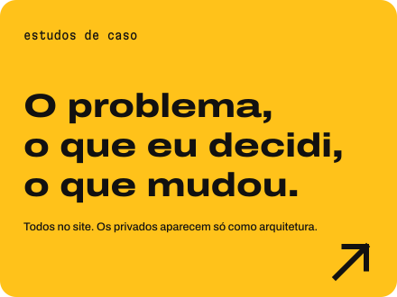</a>

No GitHub público: [clean-node-api](https://github.com/ErickScur/clean-node-api) (Clean Architecture e TDD, 2022) e [Órbita](https://github.com/ErickScur/FAG-orbita), um jogo 2D em Godot (2026).

## O ano inteiro, como relevo

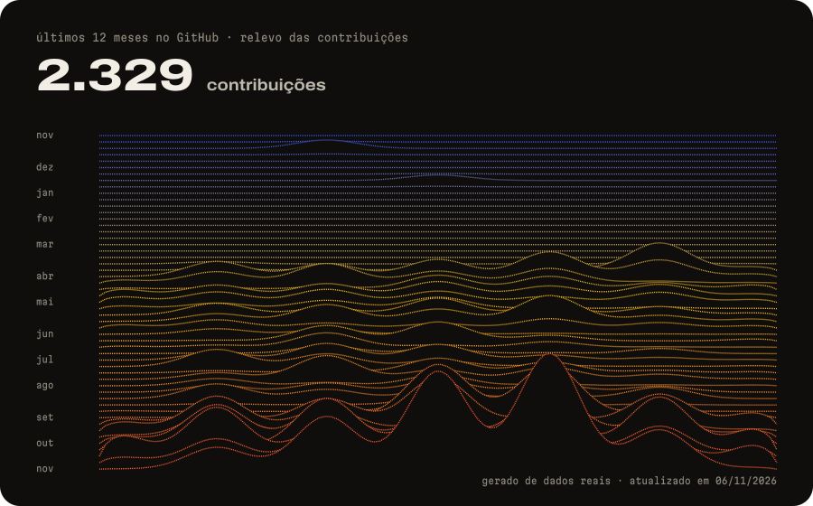

Cada linha é uma semana e cada pico é um dia. Os dados vêm do meu calendário de contribuições, e uma Action redesenha o gráfico todo dia.

## Como eu trabalho com IA

IA aplicada a problema de negócio é a minha direção agora. Quatro regras que eu sigo, e onde cada uma está implementada.

| Regra | Na prática | Onde |
|---|---|---|
| **Regra que importa vira código, não prompt.** | Toda escrita destrutiva ou externa passa por um hook antes de executar. O modelo pode esquecer uma instrução. O hook não esquece. | Nerso |
| **Toda escrita feita por IA pede confirmação.** | As 59 ferramentas de escrita só executam depois que o consultor confirma. A mesma chamada repetida em 2 minutos devolve o resultado anterior. | Juntos360 |
| **Custo é métrica de produto.** | Registro mecânico vai para o modelo rápido (US$ 0,47 → 0,047 por turno). Cada turno tem teto de gasto e vai para um log de custo. | Nerso |
| **O agente escreve. Os gates decidem.** | Nada entra sem passar por lint, typecheck, teste, build, smoke, mutação, regressão de voz e auditoria de privacidade. | Nerso Voz |

## Carreira

<a href="https://erickscur.com.br/#carreira"></a>

<b>Os 15 passos, em texto</b>

| Quando | Onde | O quê |
|---|---|---|
| 2018–2021 | Instituto Federal Catarinense, Videira | Técnico em Informática |
| jun 2020 | Scur T.I. | Abro a minha primeira empresa |
| nov 2020 | Whap Soluções Web | Estágio full stack, PHP e Magento |
| abr 2021 | ADV Tecnologia | Backend de help desk em tempo real |
| mar 2022 | Premiersoft | Único backend de um marketplace automotivo, atendendo Web, Android e iOS |
| jan 2023 | 1% Programador | Cofundo o canal com o Pedro, meu sócio |
| fev 2023 | Nestlé, via NH Labs | Backend sênior, na migração de uma plataforma de e-commerce enterprise |
| jul 2023 | Centro Universitário FAG | Engenharia de Software, formatura em julho de 2027 |
| 2025 | Dev de Verdade | Curso full stack, mais de R$ 40 mil em vendas |
| jun 2025 | Candidatus | SaaS de carreira com IA. O motor de recomendação é o nosso TCC |
| abr 2026 | 1% Programador | E-book de 163 páginas sobre Claude Code, dez guias gratuitos e CRM próprio |
| abr 2026 | Nerso | Primeiro commit do meu assistente pessoal com IA |
| jun 2026 | Acordi & Scur | Juntos360, com 120 ferramentas MCP |
| jul 2026 | Nestlé, via NH Labs | Staff Engineer, responsável técnico pela migração e por um time de devs |
| out 2026 | 1% Programador | Os Reels passam a ser montados pelo pipeline |

## Bora conversar?

